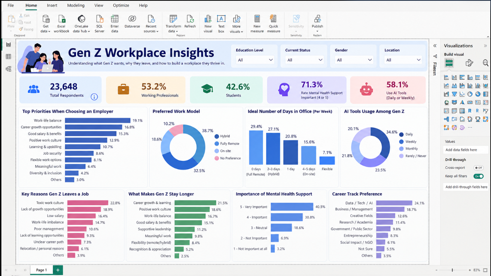
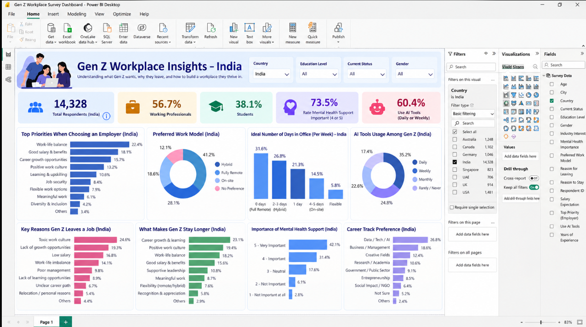

# 📊 Gen Z Workplace Insights Dashboard | Power BI, Excel & AI Automation

An end-to-end data analytics project exploring Gen Z workplace expectations, career aspirations, work-life balance, employee retention, and AI tool adoption using **Microsoft Excel, AI-assisted automation, and Power BI**.

The project transforms survey data into meaningful business insights to help organizations better understand what attracts Gen Z employees, why they leave jobs, and what encourages them to stay.

## 📁 Project Files

- **[📥 Download the Cleaned Survey Dataset](1791608093788-clean%20Survey%20Data.zip)**
-  Cleaned survey data used for exploratory data analysis and dashboard development.
- **Global Dashboard** — Overview of workplace preferences and trends across countries.
- **India Dashboard** — Country-filtered analysis of Indian respondents.
- **README.md** — Project documentation.

## 🖥️ Dashboard Preview

### 1. Global Gen Z Workplace Insights



This dashboard provides a global overview of Gen Z workplace preferences, including employer priorities, preferred work models, reasons for leaving jobs, employee retention factors, mental-health support, and AI tool usage.

### 2. India Gen Z Workplace Insights



This dashboard focuses on respondents from India and presents country-specific insights into career priorities, workplace flexibility, salary expectations, mental-health support, and AI adoption.

## 🤖 Excel + AI Automation

This project explores how **AI can support and automate parts of the Excel data analysis workflow**, helping reduce repetitive manual work and making survey analysis more efficient.

Key applications include:

- **Data cleaning:** Identifying missing values, inconsistent entries, and duplicate records for review.
- **Exploratory data analysis (EDA):** Using AI assistance to explore patterns, trends, and relationships in survey responses.
- **Insight generation:** Summarizing findings and translating data patterns into business-oriented observations.
- **Analysis support:** Assisting with Excel formulas, data transformation logic, and interpretation of results.
- **Dashboard preparation:** Preparing structured data for visualization in Power BI.

*Note: AI assistance supports the analytical workflow; it does not imply that every Excel operation or dashboard refresh is fully automated.*

## 📈 Business Questions Explored

- What are Gen Z's top priorities when choosing an employer?
- How important are salary, career growth, and work-life balance?
- Which work models do respondents prefer: hybrid, remote, or on-site?
- What are the commonly reported reasons for leaving a job?
- Which factors encourage employees to remain with an organization?
- How important is mental-health support in the workplace?
- How frequently do respondents use AI tools?
- Which career tracks are most appealing to respondents?

## 🛠️ Tools & Technologies

| Tool | Purpose |
|---|---|
| Microsoft Excel | Data preparation, cleaning, and analysis |
| AI-assisted automation | Support for repetitive analysis tasks and insight generation |
| Microsoft Power BI | Interactive visualizations, KPI cards, charts, and filters |
| Data visualization | Communicating trends and business findings |

## 🔍 Key Dashboard Metrics

The dashboards include:

- Total survey respondents
- Working professionals and students
- Employer priorities
- Preferred work arrangements
- Ideal number of office days per week
- AI tool usage frequency
- Reasons for leaving and staying
- Importance of mental-health support
- Career track preferences

## 🚀 How to Explore This Project

1. Clone or download this repository.
2. Open the **[📥Cleaned Survey Dataset](1791608093788-clean%20Survey%20Data.zip)** to inspect the survey data.
3. Open the screenshots in the `images/` folder to preview both dashboards.
4. Open the `.pbix` file in Power BI Desktop if you add the interactive report to this repository.
5. Explore the data and use AI assistance to investigate patterns and develop further analytical questions.

## 📂 Repository Structure

```text
gen-z-workplace-insights/
│
├── cleaned-survey-data-for-eda.xlsx
├── README.md
│
└── images/
    ├── gen-z-workplace-insights-global.png
    └── gen-z-workplace-insights-india.png
```

## 💡 Business Takeaway

Understanding Gen Z requires looking beyond a single factor such as salary or flexibility. Career growth, supportive management, workplace culture, meaningful work, and work-life balance may all influence employment decisions.

This dashboard helps explore these factors through survey data so organizations can investigate potential gaps between employee expectations and workplace practices.

## ⚠️ Data Disclaimer

The findings represent the responses available in the survey dataset. They should not automatically be generalized to every Gen Z employee. Survey sampling, missing values, and response quality should be considered when interpreting results.

## 🏷️ GitHub Topics

`power-bi` `excel` `ai-automation` `data-analytics` `business-analytics` `gen-z` `workplace-insights` `data-visualization` `survey-analysis`

---

**Project Focus:** Data Analytics | Business Intelligence | Excel + AI Automation | Power BI
